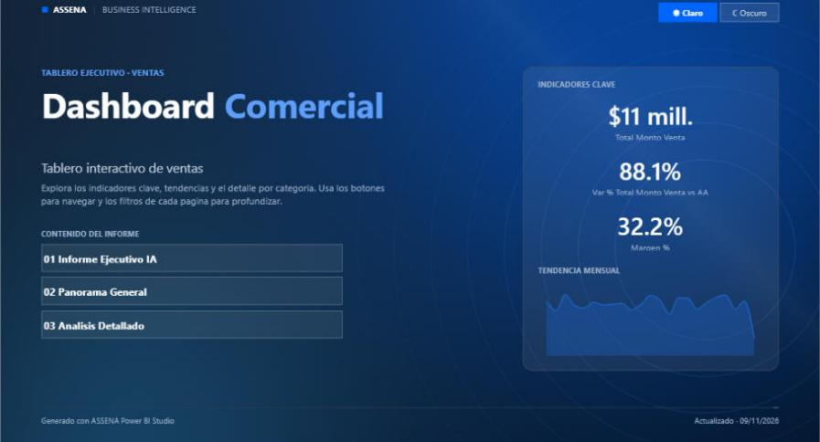

# ASSENA Skills para Claude

[](https://github.com/OWNER/assena-skills/actions/workflows/ci.yml)


Coleccion abierta de **skills de Claude** creados por **ASSENA Technologies** para
automatizar trabajo real de analitica, desarrollo y operaciones. Cada skill es un
plugin independiente que puedes instalar en segundos, usar y mejorar.



## Skills disponibles
| Skill | Version | Que hace |
|---|---|---|
| [assena-powerbi-studio](plugins/assena-powerbi-studio) | 0.5.0 | Convierte un proyecto de Power BI en blanco (conectado a tu BD) en un dashboard profesional: medidas DAX, calendario, portada, navegacion, modo claro/oscuro, tooltips y resumen ejecutivo con IA. |

## Instalar en Claude Code
```bash
/plugin marketplace add OWNER/assena-skills
/plugin install assena-powerbi-studio@assena-skills
```
Luego pidele a Claude, por ejemplo:
> Crea un dashboard de ventas profesional con mi proyecto `C:\BI\Ventas\Ventas.pbip`

Instalacion local sin marketplace (Windows):
```powershell
git clone https://github.com/OWNER/assena-skills.git
powershell -ExecutionPolicy Bypass -File assena-skills\install.ps1
```

## Probar sin base de datos
```bash
python plugins/assena-powerbi-studio/skills/assena-powerbi-studio/assets/examples/make_demo_pbip.py demo
```
Genera un proyecto de ventas con datos de ejemplo; pide a Claude que cree el
dashboard sobre `demo/DemoVentas.pbip` y abrelo en Power BI Desktop.

## Estructura
```
assena-skills/
  .claude-plugin/marketplace.json     catalogo de plugins
  plugins/<nombre>/
    .claude-plugin/plugin.json
    skills/<nombre>/SKILL.md          instrucciones para Claude
    skills/<nombre>/scripts/          automatizacion (Python stdlib)
    skills/<nombre>/references/       conocimiento de apoyo
    skills/<nombre>/assets/           paletas, marca, ejemplos
    README.md · CHANGELOG.md · LICENSE · docs/
  tests/smoke_test.py                 pruebas de humo (CI)
```

## Contribuir
¡Las contribuciones son bienvenidas! Lee [CONTRIBUTING.md](CONTRIBUTING.md) para el
flujo, las reglas de diseño y como proponer un skill nuevo. Usa las plantillas de
issues para reportar errores o sugerir mejoras.

```bash
python tests/smoke_test.py   # debe pasar antes de cada Pull Request
```

## Hoja de ruta
- assena-powerbi-studio: paginas de drill-through, marcadores, seguridad RLS, metas/presupuesto.
- Nuevos skills en preparacion bajo el prefijo `assena-`.

## Licencia
[MIT](LICENSE) © 2026 ASSENA Technologies. Power BI es una marca de Microsoft; este
proyecto no esta afiliado ni respaldado por Microsoft.
