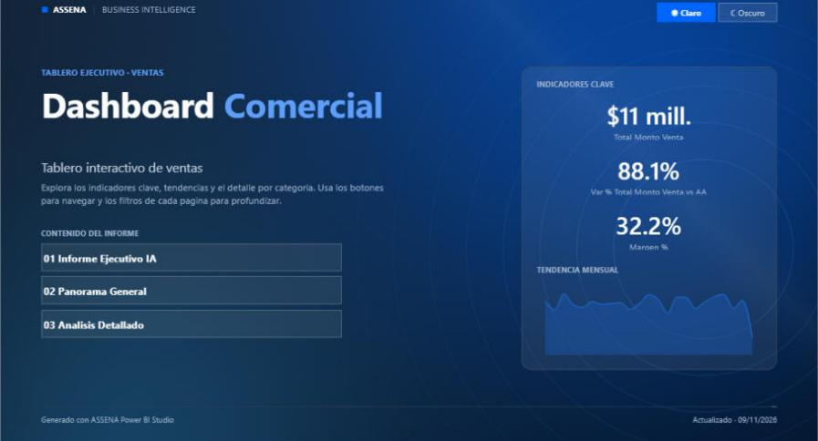
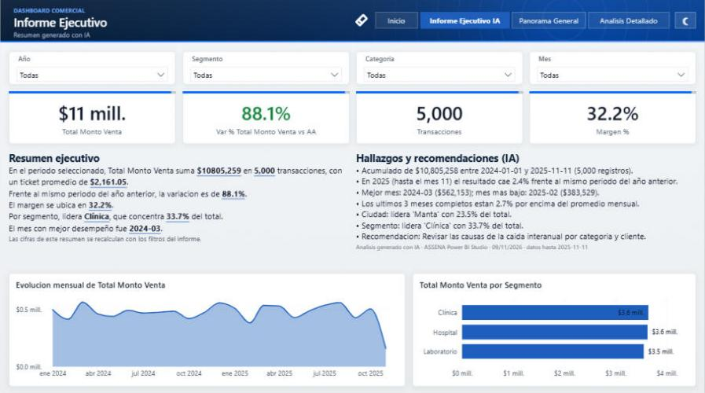
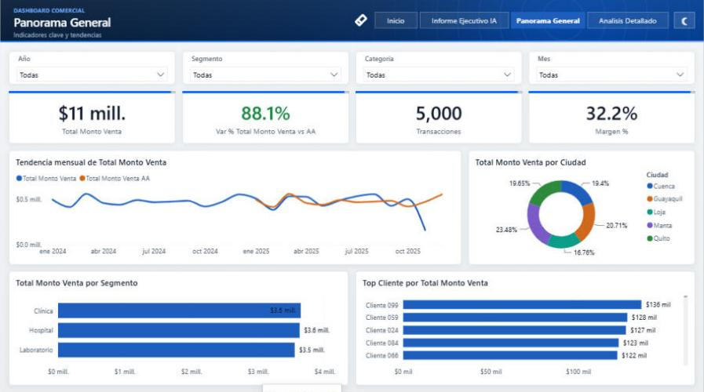
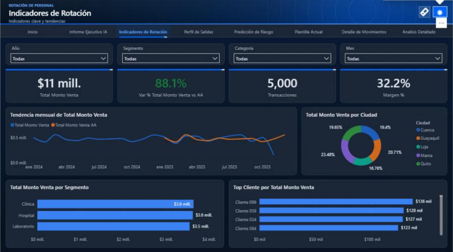

# ASSENA Power BI Studio

> Skill de Claude que convierte un proyecto de Power BI **en blanco** (solo con los
> datos conectados) en un **dashboard profesional e interactivo** — automaticamente.

| Portada con navegacion | Informe Ejecutivo IA |
|---|---|
|  |  |

| Modo claro | Modo oscuro (boton ☀/☾) |
|---|---|
|  |  |

## ¿Que hace?
1. **Analiza** tu modelo: tablas, columnas, relaciones y origen (SQL Server,
   PostgreSQL, MySQL, Oracle, Excel, CSV…).
2. **Perfila** los datos (solo lectura): rangos de fechas, cardinalidades, nulos,
   valores frecuentes.
3. **Genera** medidas DAX de negocio (totales, año anterior, variacion %, margen,
   ticket promedio…), una **tabla Calendario** y sus relaciones.
4. **Diseña** paginas con grilla profesional: encabezado de marca, segmentadores,
   KPIs, tendencias, composicion, rankings y matrices.
5. **Presenta** como producto: portada de alto impacto con indice navegable,
   selector de tema **claro/oscuro**, barra de navegacion, boton para limpiar filtros, tooltips personalizados y formato
   condicional (semaforos).
6. **Resume con IA**: pagina "Informe Ejecutivo" con narrativa que se recalcula
   con los filtros + hallazgos y recomendaciones basados en los datos reales.
7. **Aplica** un tema corporativo (7 paletas incluidas) y **valida** todo.

Resultado: abres el `.pbip` en Power BI Desktop, pulsas *Actualizar* y listo.

## Requisitos
- Power BI Desktop (2024 o superior) con guardado **PBIP + PBIR** activado.
- Python 3.8+ (solo libreria estandar). Opcional para perfilar BD:
  `pip install pyodbc` (SQL Server) · `psycopg2-binary` (PostgreSQL) · `pymysql` (MySQL).
- Claude Code (CLI, escritorio o IDE).

## Instalacion
**Desde el marketplace (GitHub):**
```bash
/plugin marketplace add fadrian-pg/assena-skills
/plugin install assena-powerbi-studio@assena-skills
```
**Local (Windows):** ejecuta `install.ps1` en la raiz del repositorio; copia el
skill a `%USERPROFILE%\.claude\skills\`.

## Uso
1. En Power BI Desktop conecta tus datos y guarda como **Proyecto (.pbip)**
   (guia: `skills/assena-powerbi-studio/references/pbip-setup.md`). Cierra Desktop.
2. En Claude Code:
   > Crea un dashboard de ventas profesional con mi proyecto `C:\BI\Ventas\Ventas.pbip`
3. Claude inspecciona, perfila, propone la spec, la mejora, aplica y valida.
4. Abre el `.pbip` → **Actualizar**.

### Uso manual de la CLI
```bash
python scripts/assena_bi.py inspect  Ventas.pbip --out model.json
python scripts/assena_bi.py profile  Ventas.pbip --trusted --out profile.json
python scripts/assena_bi.py draft    Ventas.pbip --profile profile.json --out spec0.json
python scripts/assena_bi.py insights Ventas.pbip --spec spec0.json --trusted --out insights.json
python scripts/assena_bi.py draft    Ventas.pbip --profile profile.json --insights insights.json --palette atardecer --out spec.json
python scripts/assena_bi.py apply    Ventas.pbip --spec spec.json
python scripts/assena_bi.py validate Ventas.pbip
```

### Probar sin base de datos
```bash
python skills/assena-powerbi-studio/assets/examples/make_demo_pbip.py C:/temp/demo
```
Crea un proyecto de ventas con CSV locales; aplica el flujo y abre `DemoVentas.pbip`.

## Paletas
7 paletas profesionales validadas para daltonismo, contraste y legibilidad:
`corporativo` (default) · `grafito` · `esmeralda` · `atardecer` · `oceano` ·
`clinico` · `medianoche` (oscuro) — o tus colores de marca con `paletteOverrides`.

## Seguridad
- Nunca modifica `.pbix` ni datos de origen; respaldo zip antes de cada cambio.
- Consultas de solo lectura con muestra limitada; credenciales por Windows o
  variable de entorno, nunca en texto.

## Limitaciones conocidas
- Mapas Bing obsoletos en Power BI: el skill usa barras por zona geografica.
- Marcadores y drill-through se agregan manualmente (roadmap).
- En Power BI Desktop los botones navegan con Ctrl+clic (publicado, clic normal).

## Roadmap
- Paginas de drill-through · marcadores de vistas · seguridad RLS · deteccion de metas/presupuesto · exportar resumen PDF.

Licencia MIT · Hecho por **ASSENA Technologies**.
